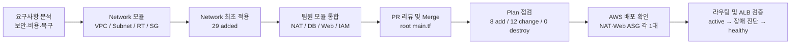
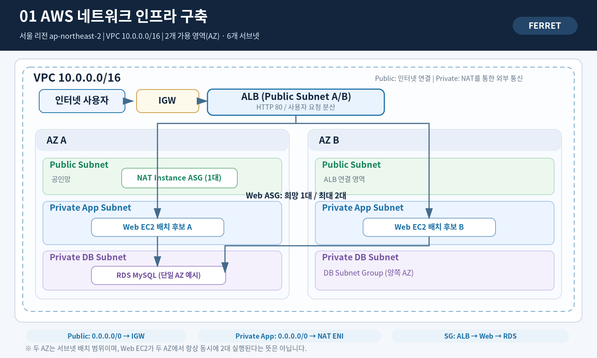
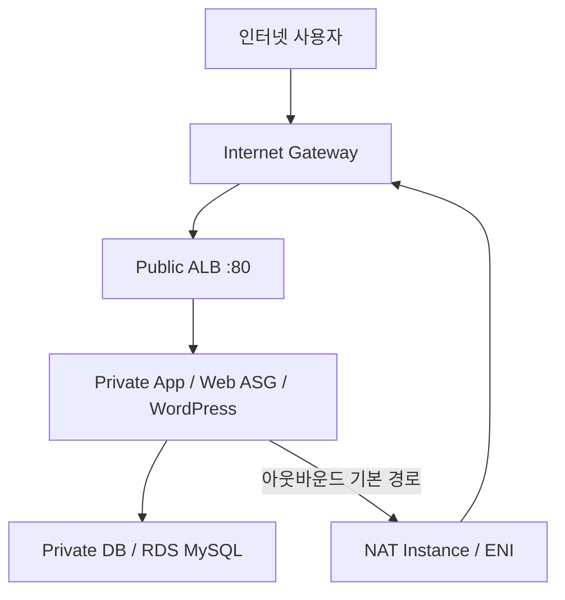
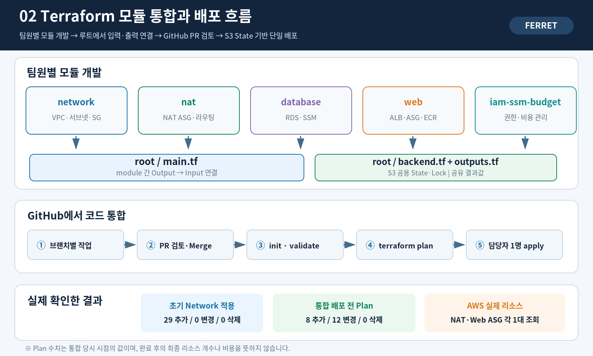
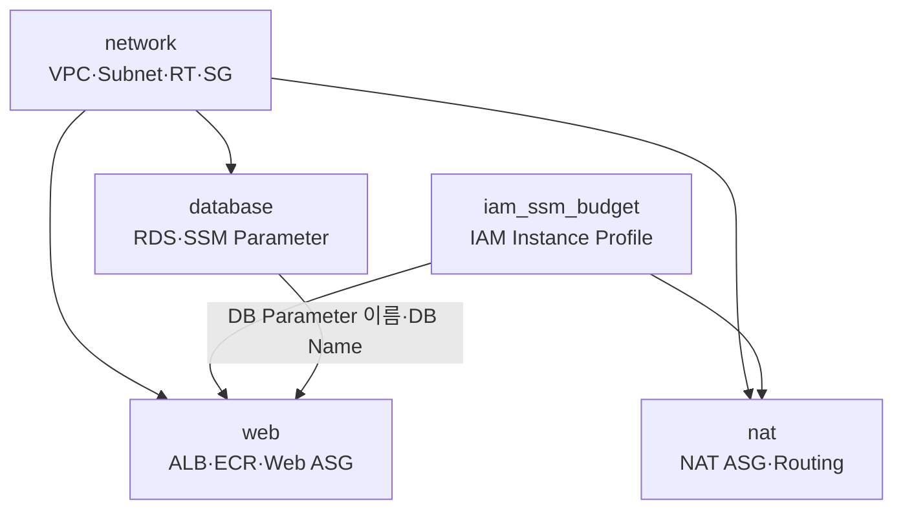

# 2026-11-03 | Ferret 해커톤 — AWS 네트워크 구축 및 Terraform 통합 실습

> **KT Cloud TechUp · Ferret 해커톤 기술노트**  
> **실습일:** 2026-11-03 (화)  
> **담당:** Network / Terraform 루트 통합 / 네트워크·HTTP 검증  
> **AWS 리전:** `ap-northeast-2` (서울)  
> **팀 프로젝트 저장소:** [`na311ng/hackathon-ferret`](https://github.com/na311ng/hackathon-ferret)  
> **문서 목적:** 당일 진행한 작업의 순서, 설계 이유, Terraform 코드 연결 방식, CLI 검증, 트러블슈팅과 학습 내용을 재현 가능하게 기록

> [!IMPORTANT]
> 본 문서는 **개인 학습·기술 기록**이며 팀 프로젝트 Terraform 코드의 원본 저장소와 별개다. 아래 계정·키·DB 암호·`.tfstate`·`.terraform/` 등 보안 정보는 개인 학습 저장소에 업로드하지 않는다. 리소스 상태는 **2026-11-03 당일 관측 시점** 기준이다.

---

## 목차

1. [오늘 한 일 한눈에 보기](#1-오늘-한-일-한눈에-보기)
2. [프로젝트 목표와 역할 분담](#2-프로젝트-목표와-역할-분담)
3. [AWS 네트워크 구성도](#3-aws-네트워크-구성도)
4. [네트워크를 이렇게 설계한 이유](#4-네트워크를-이렇게-설계한-이유)
5. [Terraform Network 모듈 구축](#5-terraform-network-모듈-구축)
6. [팀원별 Terraform 코드 통합](#6-팀원별-terraform-코드-통합)
7. [공유 Terraform State와 GitHub 협업](#7-공유-terraform-state와-github-협업)
8. [실제 AWS 배포 및 검증](#8-실제-aws-배포-및-검증)
9. [트러블슈팅](#9-트러블슈팅)
10. [격리 시나리오 검증과 모니터링](#10-격리-시나리오-검증과-모니터링)
11. [핵심 명령어 모음](#11-핵심-명령어-모음)
12. [배운 점과 다음 할 일](#12-배운-점과-다음-할-일)

---

## 1. 오늘 한 일 한눈에 보기



| 구분 | 오늘 수행·확인한 내용 | 상태 |
|---|---|---|
| Network IaC | VPC, 6개 서브넷, IGW, Route Table, Security Group 구성 | 초기 적용 완료 |
| GitHub 작업 | Network 모듈 PR, Owner 태그 PR, 루트 통합 PR | Merge 확인 |
| Terraform 통합 | Network, IAM/SSM/Budget, NAT, Database, Web 연결 | 통합 코드 Merge |
| 공유 State | S3 backend, S3 잠금 파일 방식 | 공용 State 조회 성공 |
| 초기 인프라 적용 | `29 added, 0 changed, 0 destroyed` | **실제 최초 Apply 결과** |
| 통합 계획 확인 | `8 to add, 12 to change, 0 to destroy` | **당시 Plan 결과**, Apply 결과와 구분 |
| AWS 실환경 확인 | NAT ASG 1대, Web ASG 1대, NAT Route `active` | CLI 조회 성공 |
| WordPress 웹 점검 | 처음 ALB `502`, Target `unhealthy` / 이후 Target `healthy` 공유 | 초기 장애 후 정상화 보고 |
| 침해 격리/다운타임 | 다른 팀원 격리 테스트 진행, HTTP 측정 준비 | 성공 수치·다운타임은 **미기록** |

---

## 2. 프로젝트 목표와 역할 분담

### 2.1 목표

기존 WordPress 서비스를 대상으로 다음을 구현하는 해커톤 프로젝트였다.

- **보안:** Web·DB를 외부에 직접 공개하지 않고 SSM 기반으로 접근, 침해 인스턴스 격리 시 보안그룹 및 IAM 권한 조정
- **복구:** 웹 ASG가 대체 인스턴스를 먼저 준비하고, 이후 침해 인스턴스를 분리하는 흐름
- **비용:** NAT Gateway 대신 NAT Instance, 필요 범위의 Single-AZ RDS, 예산 경고 도입
- **재현성:** Terraform 모듈화와 S3 Remote State로 인프라를 코드로 배포

> WordPress 서비스의 '무중단 복구 성공'을 오늘의 검증 없이 확정하지 않는다. ALB Target `healthy`와 격리 자동화 PASS·실제 사용자 다운타임 0초는 서로 다른 검증 항목이다.

### 2.2 역할 분담

| 담당 | 구성 요소 |
|---|---|
| 나(성민) | Network 모듈, 루트 Terraform 연결, AWS 라우팅 검증, 다운타임 측정 준비 |
| 승호 | NAT Instance, NAT ASG, 라우트 자동 설정 |
| 형서 | RDS MySQL, DB 서브넷 그룹, SSM Parameter Store |
| 나영 | ALB, Web ASG, ECR, WordPress 사용자 데이터 |
| 준용 | IAM, SSM, AWS Budget 및 자동화 관련 권한 |
| 경현 | 침해 EC2 격리·복구 테스트 |

---

## 3. AWS 네트워크 구성도



### 3.1 기본 구성

| 자원 | 설계 |
|---|---|
| Region | 서울 `ap-northeast-2` |
| VPC | `10.0.0.0/16` |
| AZ | 2개 AZ |
| Public Subnet | 2개 — 인터넷 연결 ALB, NAT 인스턴스 배치 |
| Private App Subnet | 2개 — WordPress 웹 인스턴스 |
| Private DB Subnet | 2개 — RDS DB Subnet Group |
| NAT | NAT Instance ASG, 희망 대수 1 |
| Web | Web ASG, 희망 대수 1·최대 2 |
| Database | RDS MySQL, **Single-AZ** |

**주의:** 2개 AZ에 서브넷을 만들었다는 사실만으로 RDS가 Multi-AZ이거나 Web EC2가 항상 2대 실행된다는 뜻은 아니다.

### 3.2 트래픽 경로



| 상황 | 트래픽 경로 |
|---|---|
| 사용자가 접속 | Internet → IGW → ALB → Web EC2 |
| WordPress가 DB 조회 | Web EC2 → VPC 내부 local 경로 → RDS |
| Web이 패키지·이미지 다운로드 | Web EC2 → Private Route Table → NAT ENI → NAT Instance → IGW → Internet |
| 운영자 관리 | 가능하면 SSM Session Manager·Run Command 이용 (외부 SSH 노출 불필요) |

---

## 4. 네트워크를 이렇게 설계한 이유

### 4.1 VPC CIDR: 왜 `10.0.0.0/16`인가?

- `10.0.0.0/16`은 사설 IP 대역이고 범위는 `10.0.0.0 ~ 10.0.255.255`이다.
- `/16`의 서브넷 마스크는 `255.255.0.0`이고 이론상 IPv4 주소 **65,536개**를 포함한다.
- 전체 주소 공간을 기능별 서브넷으로 잘게 나누기 위해 여유 있는 범위를 사용했다.
- `/24` 서브넷은 256개 주소를 포함하며 AWS 예약 주소 5개를 제외하면 일반적으로 **251개**를 사용할 수 있다.
- 주의: VPC 연결(VPN/Peering/TGW) 시 중복 CIDR을 쓰면 라우팅 충돌이 발생할 수 있다.

> 과거 개인 AWS 실습에 등장했던 `10.126.0.0/16`은 **이번 Ferret 해커톤의 실제 VPC CIDR이 아니다.** 실제 값은 `10.0.0.0/16`. 개별 서브넷 CIDR은 `aws ec2 describe-subnets`로 확인한다.

### 4.2 Public/Private Subnet 분리

- **Public:** `0.0.0.0/0 → IGW`가 있는 Route Table을 연결하는 인터넷 연동 영역
- **Private App:** 인터넷에서 직접 접근할 필요가 없는 Web EC2 배치
- **Private DB:** RDS에 대한 접근을 내부 웹 계층 등으로 제한

퍼블릭 서브넷이라고 모든 리소스가 외부에서 접근 가능한 것은 아니다. 리소스 퍼블릭 IP, Security Group, NACL, 라우팅이 함께 맞아야 한다.

### 4.3 `0.0.0.0/0`이란?

`0.0.0.0/0`은 **전체 IPv4 목적지에 매칭되는 기본 경로(default route)** 이다.

라우터는 **더 구체적인 경로가 있으면 그 경로를 먼저 선택**한다(longest prefix match).

| Destination | Target | 의미 |
|---|---|---|
| `10.0.0.0/16` | `local` | 같은 VPC 내부 통신 |
| `0.0.0.0/0` | IGW | Public Subnet의 외부 통신 |
| `0.0.0.0/0` | NAT ENI | Private App Subnet의 외부 통신 |

`0.0.0.0/0`은 보안그룹 인바운드 규칙에 쓰면 "어디에서나 접속 가능"이라는 뜻이 될 수 있지만, **Route Table에서는 "일치하는 구체 경로가 없으면 이 경로로 보내라"**는 의미다. 같은 문자열이라도 사용 위치에 따라 의미가 달라진다.

### 4.4 IGW와 NAT Instance의 차이

| 구분 | IGW | NAT Instance |
|---|---|---|
| 정의 | VPC 인터넷 연결 게이트웨이 | NAT 기능을 직접 수행하는 EC2 |
| 용도 | 인터넷 연결 퍼블릭 리소스 | 프라이빗 리소스의 외부 통신 중계 |
| 위치 | VPC에 연결 | Public Subnet의 EC2 |
| 외부 접속 | 퍼블릭 IP·보안 설정에 따라 가능 | 일반적으로 프라이빗 서버로의 외부 신규 연결 차단 |
| 관리 | AWS 관리형 | OS, iptables, ASG, 장애 복구를 직접 관리 |
| 선택 이유 | ALB 인터넷 접속에 필요 | NAT Gateway 대비 비용을 줄일 여지가 있음 |

**중요:** NAT Instance 비용이 항상 NAT Gateway보다 싼 것은 아니다. EC2, EBS, 퍼블릭 IPv4, 데이터 전송 요금과 운영 부담을 합쳐 비교해야 한다.

### 4.5 Security Group

| SG | 핵심적인 허용 관계 |
|---|---|
| ALB SG | 외부 클라이언트 → ALB HTTP 80 |
| Web SG | ALB SG → Web 서비스 포트 |
| RDS SG | Web SG → MySQL 3306 |
| NAT SG | Private Subnet → NAT 중계에 필요한 통신 |
| Isolation SG | 격리된 인스턴스의 통신 제한 |

라우팅은 **어디로 갈지**, SG는 **통신을 허용할지**를 제어한다. ALB SG를 Web SG의 소스로 참조하면 ALB 사설 IP가 바뀌어도 같은 보안그룹 구성에서 동작한다.

---

## 5. Terraform Network 모듈 구축

### 5.1 담당 리소스

- VPC
- Internet Gateway
- Public Subnet 2개
- Private App Subnet 2개
- Private DB Subnet 2개
- Public Route Table 1개
- Private Route Table 1개
- DB Route Table 1개
- ALB/Web/NAT/RDS/Isolation 보안그룹
- Terraform output에 VPC·서브넷·RT·SG ID 노출
- 네트워크 소유 리소스에 `Owner = network` 태그 부여

### 5.2 예시 모듈 Output 활용

**네트워크 모듈**이 실제 리소스 ID를 출력한다.

```hcl
output "vpc_id" {
  value = aws_vpc.main.id
}

output "public_subnet_ids" {
  value = aws_subnet.public[*].id
}
```

> 위 HCL은 모듈 Output의 **원리를 설명한 예시**다. 정확한 리소스 이름과 코드는 팀 저장소의 `modules/network/outputs.tf`를 기준으로 확인한다.

핵심은 **하드코딩한 VPC ID나 Subnet ID를 다른 모듈에 복사하지 않고 `module.network.*`로 전달하는 것**이다.

### 5.3 초기 적용 기록

```text
Apply complete!
Resources: 29 added, 0 changed, 0 destroyed.
```

이 숫자는 **Network 최초 적용 시점**의 실제 결과다. 이후 루트 통합 `terraform plan`의 `8 add / 12 change`와 합쳐서 "37개 생성"이라고 계산하면 안 된다.

---

## 6. 팀원별 Terraform 코드 통합



### 6.1 팀 저장소 구조

```text
hackathon-ferret/                   # 실제 팀 인프라 코드 저장소
├── backend.tf                      # S3 Remote State 및 잠금
├── main.tf                         # 각 모듈을 호출하고 연결
├── outputs.tf                      # ALB DNS, ASG, ECR URL, TG ARN 등
├── .gitattributes                  # NAT User Data의 LF 줄바꿈 관리
└── modules/
    ├── network/                    # VPC, 서브넷, 라우트, SG
    ├── iam-ssm-budget/             # IAM 프로파일·SSM·예산
    ├── nat/                        # NAT ASG·Launch Template
    ├── database/                   # RDS·SSM DB 파라미터
    └── web/                        # ALB·Target Group·ECR·Web ASG
```

### 6.2 왜 루트 `main.tf`가 필요한가?

NAT 모듈을 예로 들면 다음 정보가 필요하다.

- 어느 VPC에서 실행하는가? → `module.network.vpc_id`
- 어느 퍼블릭 서브넷에 배치하는가? → `module.network.public_subnet_ids[0]`
- 어느 Private RT의 기본 경로를 변경하는가? → `module.network.private_route_table_ids`
- 어떤 SG를 쓰는가? → `module.network.sg_nat_id`
- AWS Route API를 호출할 권한은 어디서 받는가? → `module.iam_ssm_budget.nat_instance_profile_name`

```hcl
# 루트 통합의 핵심 연결 형태
module "nat" {
  source = "./modules/nat"

  vpc_id                  = module.network.vpc_id
  public_subnet_id         = module.network.public_subnet_ids[0]
  private_route_table_ids = module.network.private_route_table_ids
  nat_sg_id                = module.network.sg_nat_id
  nat_iam_profile_name     = module.iam_ssm_budget.nat_instance_profile_name
}
```

`module.network.xxx`는 Network 모듈의 **Output**을 읽어서 NAT 모듈의 **Input**으로 전달한다는 뜻이다. 이 참조 관계는 Terraform의 의존 관계 계산에도 도움을 준다.

### 6.3 Web/DB/IAM 연결 관계



- `database`: DB Subnet IDs와 RDS SG를 입력받고 RDS MySQL 및 SSM Parameter Store의 연결정보를 구성
- `web`: ALB Public Subnet, Web Private App Subnet, ALB/Web SG, Web IAM Profile, DB Parameter 이름들을 받아 생성
- NAT: 현재 실행 중인 NAT 인스턴스 ENI를 찾아 프라이빗 기본 라우트를 생성/교체하도록 User Data 작성
- 루트 `outputs.tf`: ALB DNS/Target Group ARN/ECR Repo URL 등을 CLI에서 쉽게 확인하도록 출력

**구분할 것:** `terraform validate`와 `terraform plan`은 HCL 및 인프라 변경 계획을 검증한다. EC2 User Data 안에서 `iptables`, `dnf`, Docker가 실제로 성공했는지는 **런타임 검증이 별도로 필요**하다.

### 6.4 NAT 부팅 코드와 IAM 보완

NAT 인스턴스는 ASG에 의해 교체될 수 있다. 그러면 **ENI ID가 바뀌므로** 기존 ENI ID를 영구적으로 하드코딩하면 안 된다.

당시 User Data의 핵심 절차:

```bash
#!/bin/bash

# 1) 라우팅 가능하도록 IP Forwarding 활성화
sysctl -w net.ipv4.ip_forward=1

# 2) NAT 출구 인터페이스 파악
OUT_IF=$(ip -4 route show default |
  awk '{for (i=1;i<=NF;i++) if ($i=="dev") {print $(i+1); exit}}')

# 3) 출발지 NAT 설정 (iptables 설치·서비스 준비가 전제)
iptables -t nat -A POSTROUTING -o "$OUT_IF" -j MASQUERADE

# 4) 인스턴스 ID / ENI ID를 조회하고 Route Table 기본 경로 갱신
#    실제 AWS API 명령은 팀 저장소 modules/nat/main.tf 참조
```

이를 위해 NAT IAM 정책에 `ec2:DescribeInstances` 권한을 추가했다. Route 생성/교체를 위한 `ec2:CreateRoute`, `ec2:ReplaceRoute` 및 Source/Destination Check 해제를 위한 권한도 필요하다.

**주의:** NAT 인스턴스 내부의 `iptables`가 없거나 FORWARD 정책에 막히면 Route Table이 `active`여도 외부 통신이 되지 않는다.

### 6.5 Windows 편집 및 User Data 이슈

Windows에서 Git으로 셸 스크립트를 관리할 때 CRLF(`\r\n`)와 LF(`\n`) 차이로 Linux 사용자 데이터가 깨질 수 있다.

`.gitattributes`에 다음을 적용했다.

```gitattributes
modules/nat/main.tf text eol=lf
```

함께 경험한 문제:

- PowerShell 프롬프트에 HCL의 `module "..." { }`를 직접 입력하면 Terraform 파일이 수정되는 것이 아니고 PowerShell 명령으로 해석된다.
- HCL 편집은 VS Code에서 파일을 직접 수정하거나 PowerShell의 `Add-Content` 등 파일 쓰기 명령을 사용해야 한다.
- `Get-Content -Raw`와 인코딩 처리 과정에서 한글 주석이 깨질 수 있어 **UTF-8**과 `git diff`를 점검했다.
- `terraform plan`과 `git diff --check`로 변경 사항 확인 후 PR 생성했다.

---

## 7. 공유 Terraform State와 GitHub 협업

### 7.1 Remote State

```hcl
# 구조를 설명하기 위한 예시; 실제값은 팀의 backend.tf 확인
terraform {
  backend "s3" {
    bucket       = "<TEAM_STATE_BUCKET>"
    key          = "ferret/terraform.tfstate"
    region       = "ap-northeast-2"
    use_lockfile = true
  }
}
```

이 방식의 의의:

- 팀원이 같은 Terraform 상태를 참조
- S3 버전 관리로 State 변경 이력 보존
- S3 Lockfile로 동시 쓰기 충돌 완화
- **팀원별 `terraform apply`를 동시에 실행하지 않고 한 명이 배포 담당**

> `.tfstate`, `.terraform/`, `.tfvars`, Secret Access Key, RDS 암호 및 토큰은 개인 기술노트 저장소에 올리지 않는다.

### 7.2 GitHub PR 흐름

| PR | 핵심 작업 | 의미 |
|---|---|---|
| #3 | Network 모듈 및 공통 구조 | Network 기반 Merge |
| #6 | Network `Owner` 태그 정리 | 자원 식별·역할 정리 |
| #10 | NAT·Database·Web 루트 통합 및 NAT Route 보완 | 팀원 코드 의존성 연결 |
| #11 | Web 부팅 시 NAT 준비 대기 | NAT보다 Web 초기화가 앞서는 문제 완화 |

PR Merge와 `terraform apply`는 별개다. **Merge는 GitHub 코드 변경**, **Apply는 AWS에 인프라 반영**하는 과정이다.

### 7.3 PR #11의 Web 대기 로직 이해

Web User Data에서 SSM 서비스 엔드포인트 연결을 시도하며 일정 횟수 대기하도록 변경됐다.

- 목적: NAT 라우팅·인터넷 연결이 준비되기 전에 Web에서 `dnf`/Docker/이미지 Pull을 시작하는 문제 완화
- 한계: `curl` 단순 연결 시도는 NAT 전체 동작이나 애플리케이션 정상 상태의 완전한 판정이 아님
- 중요한 운영 사실: **PR이 Merge되더라도 이미 부팅한 기존 EC2의 User Data가 자동 재실행되지는 않는다.** Launch Template 적용 및 인스턴스 교체/재시작 전략을 별도로 확인한다.

---

## 8. 실제 AWS 배포 및 검증

### 8.1 인증·State 확인 (Windows PowerShell)

```powershell
cd $HOME\Desktop\hackathon-ferret
$env:AWS_PROFILE = "ferret-team"

# 현재 AWS 계정 확인 (공유 계정이 맞는지 검사)
aws sts get-caller-identity --query Account --output text

# 모듈이 실제 Terraform 상태에 등록됐는지 확인
terraform state list |
  Select-String 'module\.(network|nat|database|web|iam_ssm_budget)\.'
```

당일 실제 조회한 State에서 다음 리소스들의 등록을 확인했다.

```text
module.nat.aws_autoscaling_group.nat
module.nat.aws_launch_template.nat
module.web.aws_autoscaling_group.web
module.web.aws_ecr_repository.wp
module.web.aws_launch_template.web
module.web.aws_lb.main
module.web.aws_lb_listener.http
module.web.aws_lb_target_group.web
```

### 8.2 실제 ASG 인스턴스 수

```powershell
aws autoscaling describe-auto-scaling-groups `
  --auto-scaling-group-names nat-instance-asg ferret-hackathon-web-asg `
  --region ap-northeast-2 `
  --query "AutoScalingGroups[].{Name:AutoScalingGroupName,Desired:DesiredCapacity,Instances:length(Instances)}" `
  --output table
```

**실제 관측 결과:**

```text
Name                    Desired  Instances
ferret-hackathon-web-asg    1        1
nat-instance-asg            1        1
```

ASG의 `Desired=1`, `Instances=1`은 **인스턴스 존재**를 의미할 뿐 모든 User Data/서비스가 정상이라는 뜻이 아니다.

### 8.3 NAT Route

> 공개용 정리: 실제 Route Table·ENI 식별자는 자리표시자로 대체했다. 실행 시 본인 리소스 ID를 사용한다. 관측 상태와 수치는 유지했다.

```powershell
aws ec2 describe-route-tables `
  --route-table-ids <PRIVATE_ROUTE_TABLE_ID> `
  --region ap-northeast-2 `
  --query "RouteTables[0].Routes[].{Destination:DestinationCidrBlock,ENI:NetworkInterfaceId,State:State}" `
  --output table
```

**당일 결과 요약:**

```text
Destination     ENI                    State
10.0.0.0/16     local                  active
0.0.0.0/0       <NAT_ENI_ID> active
```

여기서 `0.0.0.0/0`은 기본 IPv4 경로이며 `active`는 해당 Route Table 경로가 유효하다는 뜻이다.

### 8.4 ALB·Target Group

```powershell
$tg = terraform output -raw web_target_group_arn
$alb = terraform output -raw web_alb_dns_name

aws elbv2 describe-target-health `
  --target-group-arn $tg `
  --region ap-northeast-2 `
  --query "TargetHealthDescriptions[].{Instance:Target.Id,State:TargetHealth.State,Reason:TargetHealth.Reason}" `
  --output table

curl.exe -I "http://$alb"
```

**실제 초기 장애 결과:**

```text
Target Health: unhealthy
Reason: Target.FailedHealthChecks

HTTP/1.1 502 Bad Gateway
Server: awselb/2.0
```

이후 Web 담당자가 작업하고 사용자가 **ALB Target이 `healthy`로 바뀌었다고 공유**했다. 단, 그 이후의 HTTP 200 응답값, 격리 성공 횟수, 정확한 다운타임 수치는 이 기록에서 확정하지 않았다.

---

## 9. 트러블슈팅

### 9.1 NAT Route는 active인데 인터넷이 안 됨

**현상**
- Private Route Table에 `0.0.0.0/0 → NAT ENI`가 `active`
- Web ALB는 `502`, Target `unhealthy`
- NAT 인스턴스에서 `iptables` 명령을 사용할 수 없다는 제보

**원인 후보**
- Amazon Linux 2023 이미지에 `iptables` 명령/서비스가 설치되지 않아 `MASQUERADE` 규칙 추가 실패
- 또는 IP Forwarding, Source/Destination Check, `FORWARD` 필터 정책, SG/NACL 설정 문제

**점검 명령 (NAT EC2의 SSM 터미널)**

```bash
command -v iptables
cat /proc/sys/net/ipv4/ip_forward
ip -4 route
sudo iptables -t nat -S POSTROUTING
sudo iptables -S FORWARD
```

**필요 시 조치하는 예시** — 실제 변경은 NAT 담당자와 조율한다.

```bash
sudo dnf install -y iptables-services
sudo sysctl -w net.ipv4.ip_forward=1

OUT_IF=$(ip -4 route show default |
  awk '{for(i=1;i<=NF;i++) if($i=="dev"){print $(i+1); exit}}')

sudo iptables -t nat -C POSTROUTING -o "$OUT_IF" -j MASQUERADE 2>/dev/null ||
sudo iptables -t nat -A POSTROUTING -o "$OUT_IF" -j MASQUERADE
```

정상화한 뒤에도 **ASG 교체 시 재현**이 가능해야 하므로 `modules/nat` Launch Template User Data에 영속적인 설정이 필요하다. 현재 Terraform 코드의 수정/배포 여부는 별도로 확인한다.

### 9.2 NAT 준비 전 Web 부팅 (PR #11)

**현상 가능성:** Web User Data가 `dnf install docker`, ECR Pull 등을 NAT 연결 전에 실행해 실패.

**조치 방향:** 외부 연결을 기다린 후 실행하는 루프 추가. 인스턴스 교체 전에 ECR 이미지 태그가 존재하는지 등 실제 서비스 준비 여부 추가 검증 필요.

### 9.3 Git / PowerShell / HCL 작업 오류

- PowerShell에 HCL 본문을 직접 입력하면 파일 수정이 아닌 쉘 명령 실행이 됨
- 텍스트 인코딩으로 한글 주석 깨짐 → UTF-8 확인 후 `git diff`
- Windows CRLF로 Linux 셸 내용 손상 우려 → `.gitattributes`에 LF 고정
- 원치 않는 로컬 `.terraform.lock.hcl`, `.disabled`, `.bak` 등을 무조건 `git add .` 하지 않고 `git status`로 확인 후 명시적인 경로만 스테이징

### 9.4 Grafana CloudWatch 연결 시 인증 오류

**시도:** Ubuntu VM의 기존 Grafana에 새 CloudWatch 데이터 소스를 연결해 해커톤 격리 테스트를 시각화하려고 함.

**오류:** `AWS SDK Default`가 Grafana 서버에서 AWS 자격증명을 찾지 못해 `no EC2 IMDS role found`, `169.254.169.254 ... connection refused` 발생.

**핵심:** Windows AWS CLI의 `ferret-team` 프로필은 다른 Ubuntu VM에 설치된 Grafana로 자동 전달되지 않는다. 별도의 CloudWatch 읽기 전용 자격증명 연결이 필요하다. 당일은 PPT/테스트 우선으로 설정을 보류했다.

---

## 10. 격리 시나리오 검증과 모니터링

경현님은 침해 인스턴스를 분리하는 격리 시나리오를 테스트하고, Network 담당은 **서비스 다운타임과 ALB 상태 변화를 별도로 확인**하는 역할을 수행한다.

### 10.1 관찰해야 할 지표

| 관찰 항목 | 의미 |
|---|---|
| HTTP 응답 코드 | 격리 전후 사용자 관점 서비스 연속성 |
| 요청 소요시간 | 응답 지연이 증가하는지 |
| ALB Target `healthy/unhealthy` | 신규·기존 Web 인스턴스의 서비스 수용 가능 상태 |
| Web ASG 희망/실제 대수 | 격리 시 1 → 2 → 1 흐름이 실현됐는지 |
| Security Group/IAM Instance Profile | 격리된 대상의 접근·권한 변경 여부 |
| Test Result / 타임스탬프 | PASS/FAIL, 테스트 시작·종료 시각 |

**주의:** ASG의 '1 → 2 → 1'은 **기대 시나리오**이며 실제 기록 없이 성공으로 표기하지 않는다.

### 10.2 HTTP CSV 측정 (Windows PowerShell)

아래는 보완한 예시로, 각 응답의 상태와 지연을 CSV로 남긴다. 경현님과 실행 시각을 맞춰 시작한다. `Ctrl+C`로 종료한다.

```powershell
$alb = terraform output -raw web_alb_dns_name
$url = "http://$alb/"
$log = "$HOME\Desktop\ferret-http-monitor-2026-11-03.csv"

"Time,HttpCode,LatencySec,Status" | Set-Content $log -Encoding utf8

while ($true) {
  $time = Get-Date -Format "yyyy-MM-dd HH:mm:ss.fff"
  $result = curl.exe -s -o NUL --max-time 3 -w "%{http_code},%{time_total}" $url
  $parts = $result -split ","
  $code = $parts[0]
  $latency = $parts[1]
  $status = if ($code -match '^\d+$' -and [int]$code -ge 200 -and [int]$code -lt 400) {
    "SUCCESS"
  } else {
    "FAIL"
  }
  "$time,$code,$latency,$status" | Add-Content $log -Encoding utf8
  Write-Host "$time | HTTP $code | $status | ${latency}s"
  Start-Sleep -Seconds 1
}
```

- 1초 간격은 **요청 완료 후 1초 대기**이므로 일정한 1 Hz 샘플링과 다르다.
- 관측 실패 구간은 `최초 FAIL 시각 ~ 최초 SUCCESS 복귀 시각`으로 근사한다.
- 실패 요청이 하나도 없으면 '측정 기간 동안 관측된 실패 요청 0건'으로 표현하고, 무중단을 절대적으로 보증하지 않는다.
- 실측 로그가 없으므로 이 문서에 **임의의 복구 시간이나 다운타임 수치를 넣지 않는다.**

---

## 11. 핵심 명령어 모음

### 11.1 GitHub 코드 동기화

```powershell
cd $HOME\Desktop\hackathon-ferret
git fetch origin
git switch main
git pull --ff-only origin main
git log -5 --oneline
git status
```

### 11.2 Terraform 안전 점검

```powershell
$env:AWS_PROFILE = "ferret-team"

terraform init
terraform fmt -check -recursive
terraform validate
terraform plan

# 마지막 변경에 destroy가 포함되는지 반드시 확인
terraform state list
terraform output
```

> 여러 사람이 같은 State를 쓰므로 `terraform apply`, `terraform destroy`, ASG 인스턴스 강제 교체 등 실제 변경 명령은 팀 담당자와 협의 없이 실행하지 않는다.

### 11.3 AWS 서비스 검증

```powershell
# ASG 실제 인스턴스 수 확인
aws autoscaling describe-auto-scaling-groups `
  --auto-scaling-group-names nat-instance-asg ferret-hackathon-web-asg `
  --region ap-northeast-2 `
  --query "AutoScalingGroups[].{Name:AutoScalingGroupName,Desired:DesiredCapacity,Count:length(Instances)}" `
  --output table

# ALB DNS 및 HTTP 상태
$alb = terraform output -raw web_alb_dns_name
curl.exe -I "http://$alb"

# Target Health
$tg = terraform output -raw web_target_group_arn
aws elbv2 describe-target-health `
  --target-group-arn $tg `
  --region ap-northeast-2 `
  --output table
```

---

## 12. 배운 점과 다음 할 일

### 12.1 오늘 배운 점

1. **네트워크는 리소스 생성만으로 끝나지 않는다.** Route Table이 `active`여도 OS의 IP Forwarding·NAT 주소변환·SG·서비스 기동이 맞아야 정상 통신이 가능하다.
2. **`0.0.0.0/0`의 의미를 구분해야 한다.** Public RT의 IGW 경로와 Private RT의 NAT 경로는 같은 기본 경로라도 목표가 다르다.
3. **Terraform 모듈 간 연결이 핵심이다.** 팀원이 개별 기능을 잘 만들어도 루트에서 Output/Input, 보안그룹, 인스턴스 프로파일 등을 정확히 연결해야 전체 인프라가 동작한다.
4. **Git Merge와 Apply를 구분해야 한다.** PR을 합친다고 AWS 리소스가 자동으로 바뀌지 않는다.
5. **State Lock과 배포 담당자 조율이 중요하다.** 같은 State에 동시에 Apply하면 작업 충돌 위험이 있다.
6. **발표 성과와 실제 측정값을 구분해야 한다.** Healthy는 서비스 준비 지표이며, 격리 성공·무중단 복구는 별도 실험이 필요하다.

### 12.2 후속 확인 목록

- [ ] NAT `iptables` 설치 및 재부팅·ASG 교체 후에도 경로와 MASQUERADE가 유지되는지 확인
- [ ] Web Launch Template 최신 User Data가 새 인스턴스에 반영됐는지 확인
- [ ] ALB HTTP 최종 정상 응답과 WordPress DB 연결 확인
- [ ] 격리 시나리오 PASS/FAIL·타임스탬프·SG/IAM 변경 기록 수집
- [ ] HTTP CSV 기록으로 실제 실패 요청 수·복구 소요시간 정리
- [ ] 발표 자료의 비용 절감 추정과 AWS 실측 비용 구분
- [ ] 필요하면 별도의 CloudWatch 읽기 전용 권한으로 Grafana 연결

### 12.3 회고

> 짧은 시간 안에 팀원들의 Terraform 코드를 이해하고 전체 아키텍처에 맞게 통합하는 과정이 어려웠다. 또한 VPC·서브넷·Route Table을 생성하는 것만으로 네트워크가 완성되지 않고, NAT의 패킷 전달과 주소 변환, Web 서비스의 실제 통신 상태까지 검증해야 한다는 점을 배웠다. 이를 통해 개별 리소스 구현뿐 아니라 전체 인프라 구조를 이해하고 협업하며 문제를 해결하는 능력이 중요하다는 것을 느꼈다.

---

## 참고 및 출처

- 실제 팀 Terraform 코드: <https://github.com/na311ng/hackathon-ferret> (접근 권한 필요)
- AWS CLI / Terraform State / Plan: 2026-11-03 실습 터미널에서 직접 확인한 출력
- NAT 장애 및 ALB 상태: 당일 팀원 공유와 CLI 점검 내용
- 설계도: 함께 저장된 `images/` 파일

> **다음 기록 제안:** `2026-11-04_Ferret_격리_복구_검증.md`에 실제 시나리오 결과와 측정 CSV 분석을 별도로 기록하면 날짜별 학습 이력을 관리하기 쉽다.
